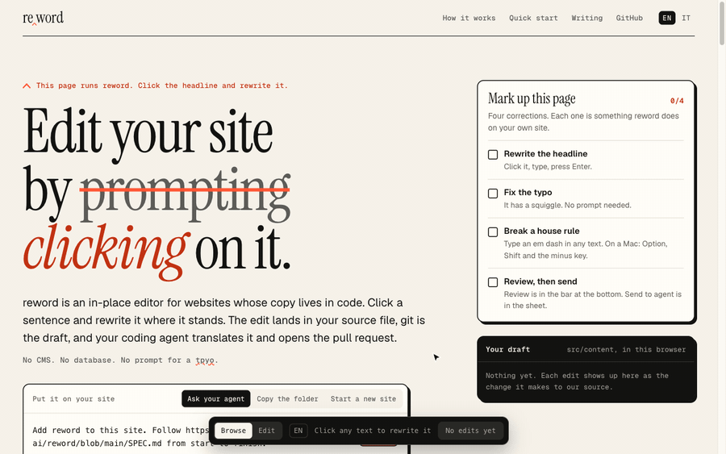
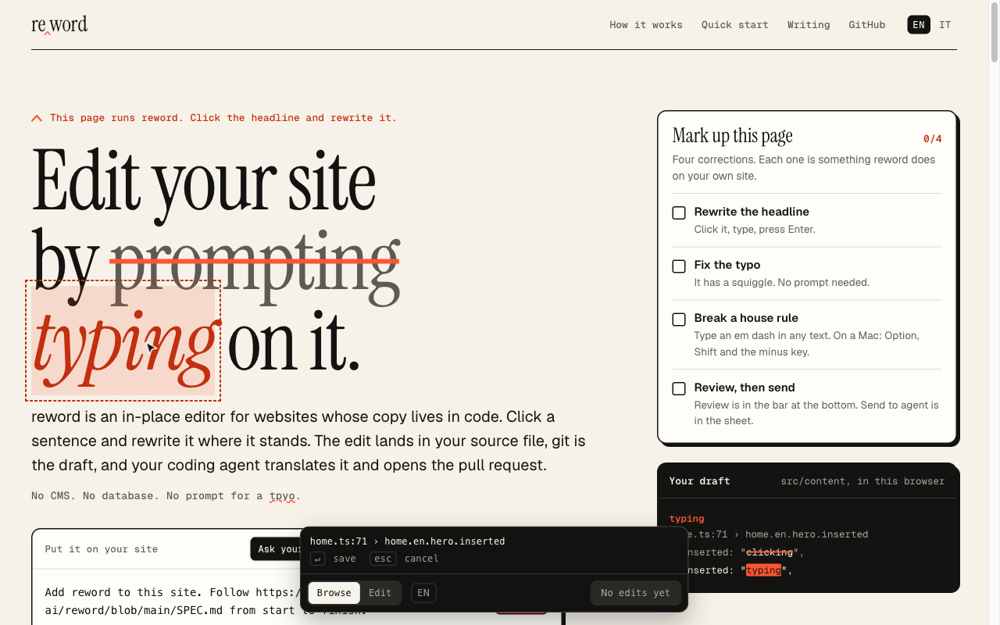
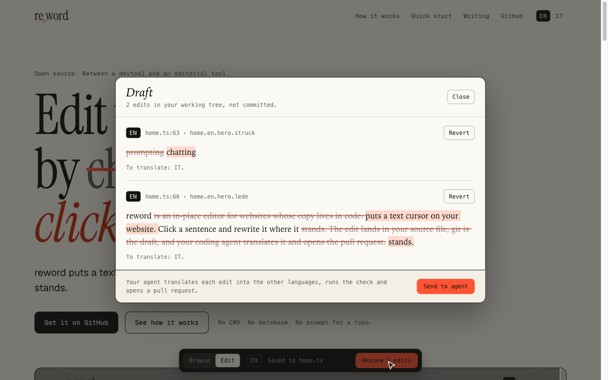
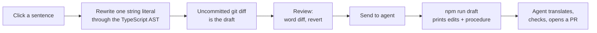

<p align="center">
  
</p>

<p align="center">
  <strong>Click a sentence on your site and reword it.</strong><br>
  An in-place editor for websites whose copy lives in code.<br>
  The edit lands in your source file, git is the draft, and your coding agent translates it and opens the pull request.
</p>

<p align="center">
  <a href="https://yempik-ai.github.io/reword/">Website</a> ·
  <a href="#quick-start">Quick start</a> ·
  <a href="#how-it-works">How it works</a> ·
  <a href="#the-handoff-any-coding-agent">Agents</a> ·
  <a href="#faq">FAQ</a>
</p>

<p align="center">
  <a href="LICENSE"></a>
  <a href="https://github.com/yempik-ai/reword/actions/workflows/ci.yml"></a>
  
  
</p>

<p align="center">
  
</p>

## What is reword?

**reword is an open-source, in-place copy editor for websites whose text lives in the source code.** You run your site locally, switch to Edit, click a sentence and rewrite it where it stands, with the typography it already has. reword saves the change into the source file by rewriting one string literal. Git is the draft. When you are done, one press hands the draft to your coding agent, which translates each edit into your other languages, runs your checks and opens a pull request.

It sits between a devtool and an editorial tool. There is no CMS, no database and no hosted service: the tool is one folder in your repository and it exists only in your dev server.

**Try it before you install it.** [The website](https://yempik-ai.github.io/reword/) runs reword in [playground mode](#playground-mode): click the headline and rewrite it. Your edits stay in your browser.

## Why

A personal site has one writer and its copy in the repo. That is the right architecture and a bad writing experience: to fix a sentence you find a string in a file, or you describe the sentence to an agent, wait, pay tokens and get words you did not write.

You already know what you want to say. Typing it is faster than describing it. What is worth delegating is everything around the sentence: the translations, the build, the pull request.

| | A headless CMS | Asking an agent in chat | **reword** |
|---|---|---|---|
| Where the copy lives | A database or a hosted service | Your repository | **Your repository** |
| How you change a sentence | Log in, find the entry, fill a form | Describe the sentence and the change, wait, check | **Click the sentence and type** |
| What you look at while you write | A form, sometimes a preview | A chat window | **The page itself** |
| Translations | A plugin, or a second pass by hand | Another prompt | **The agent writes them from your diff** |
| Review | Depends on the product | Read what the agent changed | **A word diff before the commit, a pull request after** |
| What it costs to run | A service, an API key, a schema | Tokens for every typo | **Nothing. It is part of your dev server** |

## See it

| Edit in place | Review the draft |
|---|---|
|  |  |

## Quick start

### Start a new site from this repo

This repository is a small, fast personal-site starter (home, writing, two languages) with reword built in. Its own website is the starter, unchanged.

```bash
git clone https://github.com/yempik-ai/reword my-site
cd my-site && npm install
npm run edit
```

Open `http://127.0.0.1:3000`, switch the bar at the bottom to **Edit** (or press <kbd>Cmd</kbd>+<kbd>E</kbd>) and replace our words with yours. Enter saves, Esc cancels. That is the whole tutorial.

### Add it to your Next.js site

reword is one folder, one route file and a few lines of config. No package to install beyond `zod`, which you likely have.

1. **Copy the folder.**

   ```bash
   npx degit yempik-ai/reword/src/reword src/reword
   npm install zod
   ```

   The folder comes with its tests, written for Vitest. Keep them if you use Vitest, delete the `*.test.ts` files if you do not. Its server files import each other with the `.ts` extension, so add `"allowImportingTsExtensions": true` to the `compilerOptions` of your `tsconfig.json`.

2. **Say where your copy is.** Create `reword.config.ts` at the project root:

   ```ts
   import { defineConfig } from "./src/reword/config.ts";

   export default defineConfig({
     locales: ["en", "it"],     // one entry is fine
     content: ["src/content"],  // folders whose files hold your copy
   });
   ```

3. **Add the route.** Create `src/app/api/reword/[action]/route.reword.ts`. The `.reword.ts` extension is what keeps it out of production:

   ```ts
   import config from "../../../../../reword.config";
   import { rewordRoutes } from "@/reword/routes";

   export const { GET, POST } = rewordRoutes(config);
   ```

4. **Wrap your Next.js config and mount the tool.**

   ```ts
   // next.config.ts
   import { withReword } from "./src/reword/next.ts";
   export default withReword({ /* your config */ });
   ```

   ```tsx
   // your root layout, inside <body>
   import config from "../../reword.config";
   import RewordMount from "@/reword/Mount";

   <RewordMount config={config} />
   ```

5. **Add the scripts.**

   ```json
   {
     "edit": "REWORD=1 next dev --webpack --hostname 127.0.0.1",
     "draft": "node scripts/draft.ts"
   }
   ```

   `--webpack`: on Next.js 16.4, Turbopack fails to resolve `next/font/google` once a page extension is added. Without `next/font`, Turbopack works too.

   Copy [`scripts/draft.ts`](scripts/draft.ts) too. It is six lines. Add `/.reword/` to your `.gitignore`: a custom agent command writes its log there.

Your page must say which language it is in with `<html lang>`. That is how reword knows which copy to load. If your site has a Next.js `basePath`, pass it to the mount: `<RewordMount config={config} basePath="/docs" />`.

### Let your agent install it

The repository has a porting guide written for coding agents: [SPEC.md](SPEC.md). Paste this into yours:

```text
Add reword to this site. Follow https://github.com/yempik-ai/reword/blob/main/SPEC.md from start to finish.
```

## How it works



1. **Index.** The dev server parses your content files with the TypeScript compiler and lists every string literal that sits in plain data. Each one gets an address made of property names and array positions, for example `essays.en[0].body[3].text`.
2. **Match.** The browser receives the copy of the current language and walks the page. Your components render strings untouched, so a text node that equals a content string *is* that string. No markers, no wrapper components, no invisible characters. The hover mark is the CSS Custom Highlight API, so the page is not modified to draw it.
3. **Edit.** The text node is emptied, never removed, and one `contenteditable="plaintext-only"` span is placed next to it. It inherits the typography of its place. React's tree is never changed.
4. **Save.** The save carries the file, the address, the text you saw and the text you typed. The server refuses if that text is no longer what the file says (compare-and-swap), replaces that one literal, keeps its quote style, parses the result and checks that nothing else changed. It reads the file once more just before the write and refuses if anyone else saved it in the meantime. The write is atomic and one at a time.
5. **Draft.** Nothing is stored. The draft is the difference between your last commit and your working tree, read literal by literal. Each edit is paired with the same address in your other languages.
6. **Handoff.** One constant sentence goes to your agent. `npm run draft` prints the edits and the procedure to publish them.

More detail: [Git is the draft](https://yempik-ai.github.io/reword/en/writing/git-is-the-draft/).

## The handoff: any coding agent

The agent needs one sentence, because one command prints everything else. That is why reword is not tied to a tool.

| Agent | Setup | What happens when you press Send to agent |
|---|---|---|
| **[T3 Code](https://github.com/pingdotgg/t3code)** | None. `agent: "auto"` finds its CLI. If your T3 project has no default model, name one: `agent: { t3: { provider, model } }` | A thread starts in your project and you watch it work |
| **Claude Code** | `agent: { command: "claude", args: ["-p", "{prompt}", "--permission-mode", "acceptEdits"] }` | A headless session starts, its output goes to `.reword/agent.log` |
| **Codex** | `agent: { command: "codex", args: ["exec", "--sandbox", "workspace-write", "{prompt}"] }` | A non-interactive run starts, its output goes to `.reword/agent.log` |
| **Anything else** | `agent: "clipboard"`, or do nothing | reword shows the sentence and a Copy button. Paste it into Cursor, Gemini CLI, or the session you already have open |

`{prompt}` and `{root}` are filled in. The command runs without a shell. Give a headless agent the permissions your setup needs for `git` and your checks: the examples above are a start, not a recommendation.

The sentence is always the same:

```text
Publish the reword draft: the uncommitted copy edits in this repository. Run `npm run draft` and follow the procedure it prints, from start to finish.
```

### What the agent reads

`npm run draft` prints the brief. This one is real output from this repository, with the procedure shortened:

```markdown
# reword draft

1 copy edit in the working tree, each written by the author in the locale shown.

## 1. en · src/content/home.ts:69 · `home.en.hero.note`

Before:
> No CMS. No database. No prompt for a typo.

After:
> No CMS. No database. No tokens spent on a typo.

Same copy in the other locales:
- it · src/content/home.ts:270 · `home.it.hero.note`
  > Niente CMS. Niente database. Niente prompt per un refuso.

## Procedure

1. Work in this folder: the draft is uncommitted here ...
2. Branch: `git switch -c copy/<short-topic>` ...
3. Translate. For each edit, compare Before and After ...
```

The procedure tells the agent to keep your text as you wrote it, change only what you changed in the other languages, run your check, and open a pull request. Merging stays your decision.

## Configuration

`reword.config.ts`, with `defineConfig`. Only `locales` is required.

| Option | Default | What it does |
|---|---|---|
| `locales` | required | The languages of the site. One entry means a single-language site: reword then skips translation |
| `content` | `["src/content"]` | Folders whose `.ts`, `.tsx`, `.js` and `.jsx` files hold the copy |
| `agent` | `"auto"` | `"auto"` (T3 Code if it starts a thread, otherwise the sentence to paste), `"t3"`, `{ t3: { provider, model } }`, `"clipboard"`, or `{ command, args }` |
| `check` | `"npm run build"` | The command the agent must pass before it commits |
| `forbid` | `[]` | House rules: `{ pattern, message }`. Refused while you type, with your message. This repo forbids the em dash |
| `structuralKeys` | `slug`, `id`, `href`, `date` ... | Single-language sites only: property names that are never copy |

Two attributes for your markup:

- Links that carry `hreflang` keep working in Edit mode, so your language switcher switches the language you edit.
- `data-reword-pass` on any element keeps it working in Edit mode.
- `data-reword` on any element makes it reword's own: never read as copy, never stopped. Put it on parts of your page that repeat copy, such as a live preview.

## Playground mode

A public demo of reword on your own site, off by default. Visitors click your copy and rewrite it where it stands, review their word diff and press Send. Nothing they type leaves their browser.

```bash
npm run playground                              # parses your content into public/reword-copy.json
NEXT_PUBLIC_REWORD_PLAYGROUND=1 next build      # with withReword in next.config.ts
```

Add `/public/reword-copy.json` to your `.gitignore`: it is written on every build. Copy [`scripts/playground.ts`](scripts/playground.ts) with the folder.

**What a playground build ships:** the editor's browser half (the bar, the review sheet, the page matcher) and a backend that lives in the visitor's browser. Your content files are parsed once, at build time, into a static JSON index. In the browser that index is the last commit, the visitor's edits are kept in `localStorage`, and the same functions as on the dev server compute the copy, the draft, the word diff and the brief. An edit is kept only while the text it replaced is still what the build says (compare-and-swap), so a deploy that changes a sentence drops the edits made to its old text.

**What it does not ship:** the route that writes files (there is no `/api/reword`), the TypeScript compiler, git, or any server. Send to agent cannot start an agent from a browser: it shows the brief the agent would read. CI checks all of this on every change.

**How it behaves:** a plain click on copy opens it even in Browse mode, while links, buttons and anything interactive keep working. Edit mode (the bar, or <kbd>Cmd</kbd>+<kbd>E</kbd>) works as on the dev server: link text becomes editable and links rest. A static page never re-renders, so saved copy is written into the page by the same rule as the edit: React's nodes are emptied or hidden, never removed, and copy with `[label](href)` links is shown in one span of reword's own.

**Events for your page.** reword dispatches DOM events on `window`, typed through `WindowEventMap`, so a site can build around the editor without reaching into it. This website uses them for its guided tour and its ending.

| Event | When |
|---|---|
| `reword:session` | A text opens, changes or closes. `detail`: the literal, the text as typed, the refusal if any, or `null` |
| `reword:draft` | The draft was read. `detail`: the draft |
| `reword:review` | The review sheet opened |
| `reword:send` | Playground only, cancelable. `detail`: the draft, the brief and the prompt. Call `preventDefault()` to show your own ending; otherwise the sheet shows the brief |
| `reword:open-text` | Dispatch it to open the first text inside `detail.element`: a keyboard path to editing |
| `reword:open-review` | Dispatch it to open the review sheet |

## What is editable

**On a multilingual site the data decides.** A string is copy when it is inside a locale, the same address exists in every other locale, and the text differs in at least one of them. A value that is identical everywhere is a slug, a date, a block type or a brand name, and reword will not open it. There is no list of field names to maintain.

**On a single-language site** there is no translation to compare with, so reword decides from the property name (`structuralKeys`) and the shape of the value: URLs, paths, dates and e-mail addresses are closed. Your check is the second line of defence.

Content can be organized as locale keys (`{ en: {...}, it: {...} }`), locale variables (`const en = [...]`) or locale files (`posts.en.ts`, `posts.it.ts`). Strings may contain `[label](href)` links: reword matches the rendered paragraph and lets you edit the source, links included.

| Not editable in place | Why | What to do |
|---|---|---|
| Template strings with variables, concatenations, function calls | They are logic, and a rewrite could change how the file runs | Split them into plain strings |
| Text typed inside components (JSX) | It is not in a content file | Move it to a content file |
| Arrays joined in a component (`lines.join(" · ")`) | The page shows a string that exists nowhere in the source | Join with CSS, or keep one string |
| Text changed by code before it renders (trimmed, upper-cased) | It no longer equals its source | Do the change in CSS |
| Titles, descriptions, alt text | They are copy, but not text on the page | Edit the file, or ask your agent |
| JSON message catalogs | Not parsed yet | See the roadmap |

A click on text that is not editable says so in the bar. Nothing fails silently.

## Safety

reword writes files and can start an agent, so it is built to exist in one place only: a dev server on your machine.

- **Not in production.** The API route is a file named `route.reword.ts`. That extension is a page extension only in the dev server started with `REWORD=1`. A production build and a plain `npm run dev` do not contain the route. The interface is loaded with a condition resolved at build time, so production has neither the import nor the code.
- **Playground builds are opt-in.** With `NEXT_PUBLIC_REWORD_PLAYGROUND=1` a build ships the editor's browser half and a static index of your copy, and still no route, no compiler and no server. That index holds every string literal of your content folders, including any that no page shows: keep nothing private there.
- **Loopback only.** `npm run edit` binds to `127.0.0.1`. Every request must carry a loopback `Host` (this stops DNS rebinding).
- **Same origin only.** `Sec-Fetch-Site` must be `same-origin`. Writes need a matching `Origin` and a JSON body, so another site open in your browser cannot read your draft or write through a form.
- **One string at a time.** A save can name only a literal that the server's own index lists, and can change only its value. Your text is serialized as a string literal, so it cannot become code.
- **Inside your content folders.** reword reads and writes only files that are physically inside the folders you configured. A symbolic link that leads out of them is ignored.
- **A constant prompt.** Nothing typed in the browser reaches a command line. Agent commands run without a shell.

Found a problem? See [SECURITY.md](SECURITY.md).

## FAQ

### What is reword?

reword is an open-source, in-place copy editor for websites whose text lives in the source code. You click a sentence on your running site, rewrite it, and reword saves the change into the source file. A coding agent then translates the edit and opens a pull request.

### Is reword a CMS?

No. reword has no database, no admin panel and no hosted service. Your content stays in typed files in your repository, and git holds the draft and the history. It replaces the editing comfort of a CMS, not its storage.

### Does reword work without T3 Code?

Yes. T3 Code is the built-in handoff, and any other agent works with one line of config or one pasted sentence: Claude Code, Codex, Cursor, or any tool that can run a command. Editing itself needs no agent at all.

### Which frameworks does reword support?

Today reword runs in Next.js App Router sites whose content is in TypeScript or JavaScript files. The parser, the draft logic and the page matcher do not depend on Next.js, and [SPEC.md](SPEC.md) explains how to port the rest.

### Is it safe to run?

The part of reword that writes files exists only in a development server on your own machine. It is not part of a production build, it answers only loopback and same-origin requests, and it can change only the value of a string that already exists.

### How can the website be editable, then?

It is built in [playground mode](#playground-mode), an opt-in for demos. The build ships the editor's browser half with a backend that lives in your browser. Your edits stay in local storage and never leave it. There is no route that writes files and no server.

### Can reword edit a site that has one language?

Yes. On a single-language site reword skips translation and decides what is copy from the property name and the shape of the value. The agent then only runs your checks and opens the pull request.

### How is this different from visual editing in Sanity, Tina or Vercel?

Those tools connect a page to a content store, and they typically need the page to carry markers: wrapper components, data attributes or invisible characters in every string. reword has no store and no markers. It compares the text on the page with the strings in your files, so there is nothing to add to your components and nothing in your production HTML.

### How much does reword cost?

Nothing. reword is MIT licensed and runs inside the dev server you already have. Editing uses no tokens. Only the handoff uses your agent, once per draft.

## Requirements

- Next.js App Router. Built and tested on Next.js 16. The parts reword uses (`pageExtensions`, route handlers) are older than that; on another version, check the route gate first ([SPEC.md](SPEC.md), step 1).
- React 19.2 or newer.
- Node.js 22.18 or newer (the draft script runs TypeScript directly).
- The `typescript` package, version 5 or 6. reword uses its compiler API.
- A git repository with at least one commit.
- A current browser: Chrome, Edge, Safari or Firefox from 2025 on.

## Roadmap

- JSON message catalogs (`next-intl`, `i18next`).
- A panel for copy that is not on the page: titles, descriptions, alt text.
- Adapters for Astro and SvelteKit.

Issues and pull requests are welcome: [CONTRIBUTING.md](CONTRIBUTING.md).

## Development

```bash
npm install
npm run edit      # the site with reword, on 127.0.0.1
npm run dev       # the site without it
npm run play      # the site in playground mode, as it is deployed
npm run draft     # the pending draft, as the agent reads it
npm run check     # lint, types, tests, build
```

The tool is in [`src/reword`](src/reword): the server half at the top level, the browser half in `client`. Everything else is the starter site. Its guided tour and the playground's ending are in `src/components/play`, built on the events above.

## Credits

Built by [Simone Bova](https://simonebova.com) at [Yempik](https://www.yempik.com). reword was extracted from simonebova.com, where it edits about 3,300 strings in three languages.

## License

[MIT](LICENSE)
